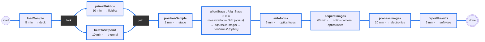
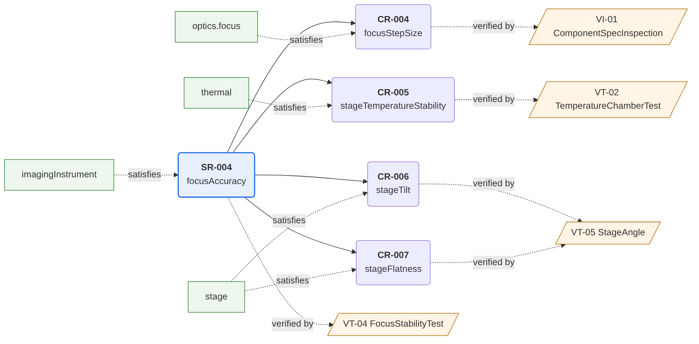
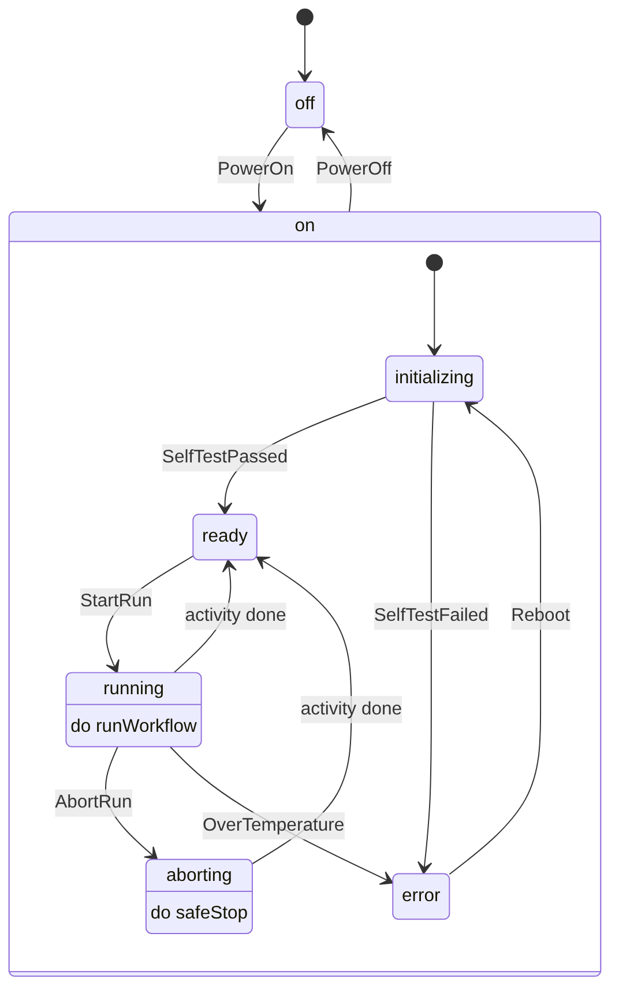
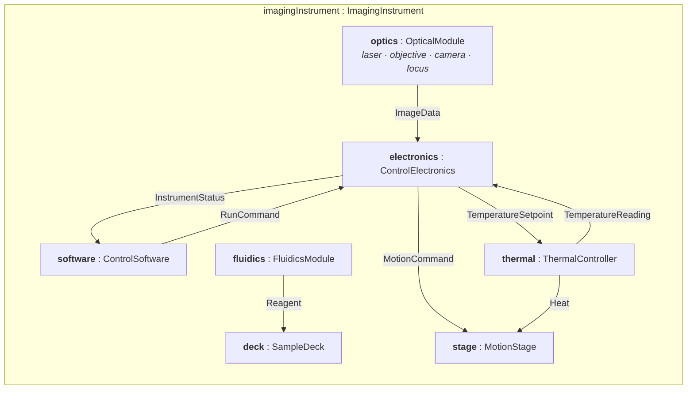

# Benchtop Imaging Instrument: SysML v2 Model with Automated Model Checks

A self-directed MBSE project. A generic benchtop imaging instrument is modeled in **SysML v2** (textual notation) in CATIA Magic / Cameo SysML v2 Community Edition. A Python checker then verifies the model's traceability and generates views from it.

The instrument is fictional and generic. It does not describe any real product, and its numbers are illustrative.

## At a glance

| Area | What the model contains |
|---|---|
| Requirements | 5 system requirements (SR) and 7 derived component requirements (CR). Each one has a parent (unless it is a system requirement), a part that satisfies it, and a verification activity. |
| Structure | 7 subsystems connected through typed ports, with item flows for image data, motion commands, temperature setpoint and reading, heat, and reagent |
| Verification | 8 activities using Test, Analysis and Inspection |
| Analysis | Focus error budget (RSS) computed from design attributes: **0.391 µm** against ±0.5 µm, **0.109 µm** margin |
| Behavior | Run workflow with parallel preparation (fork/join) and a stage-alignment sub-procedure; instrument state machine with 6 states and 10 transitions |
| Allocation | Every workflow step and state activity is allocated to a part |
| Model check | **0 errors, 0 warnings** |

## Design decisions captured in the model

- **The focus error budget drives the component requirements.** SR-004 (±0.5 µm focus) is split into four contributors: drive quantization, thermal drift, stage flatness and autofocus repeatability. CR-004, CR-005 and CR-007 come from that split. The stage tilt limit (CR-006, 0.5 mrad) was sized from the same budget: at 1 mrad, tilt alone would use up nearly all of the remaining margin.
- **Stage alignment runs in every run, after heating and before autofocus.** Each sample load can seat at a slightly different angle, and heating changes the stage geometry, so leveling has to happen at operating temperature. Aligning in every run also means the stage needs motorized tilt adjustment.
- **Run time is checked with a critical path.** The two parallel preparation steps tie at 10 minutes. The critical path is 110 minutes against SR-001's 120-minute limit, a 10-minute margin.
- **Safety behavior is traced like any other requirement.** The state machine's over-temperature transition led to SR-005. SR-005 is satisfied by the state machine and verified by a fault-injection test (VT-06).

## Automated model checks

`tools/model_check.py` reads the exported SysML v2 text and uses only the Python standard library. It writes `reports/model_report.html` and `reports/model_report.md`, a coverage matrix (`reports/coverage_matrix.csv`), and Mermaid diagram sources.

| # | Check | What it looks for |
|---|---|---|
| 1 | Requirement coverage | Every requirement has a parent, a satisfy, and a verify |
| 2 | Requirement quality | One "shall", a measurable value, none of the usual vague words |
| 3 | Verification consistency | A standard method (Test, Analysis, Inspection, Demonstration) that matches the ID prefix, and pass criteria that state the requirement's values and units |
| 4 | Functional allocation | Every function is assigned to a part, and every part has a function or a requirement |
| 5 | Workflow | Dead ends, unreachable steps, fork/join balance, critical path and slack |
| 6 | State machine | Reachability, dead-end states, undefined triggers, and one generated test case per transition |
| 7 | Analysis | Evaluates computed attributes, such as the error budget, from the design values |
| 8 | Diagrams | Structure and interfaces, workflow, states, requirement tree, and a traceability thread for each system requirement |

**What the first run caught.** The first run found 1 error and 8 warnings.

- **The error was a missing link in the workflow.** One parallel preparation step never connected to its join, so the workflow could not continue after it. The modeling tool's diagram still showed the arrow, but the model itself had lost the link. The check caught what the picture hid.
- **The warnings** included:
  - a test whose pass criteria did not state the tilt and flatness limits it was meant to verify
  - two functions that were not allocated to any part
  - a part (the laser) with no function

All of these were fixed in the model.

```
python tools/model_check.py BenchtopImager.sysml
python -m unittest discover tests
```

GitHub Actions runs both commands on every push (`.github/workflows/model-check.yml`). A model change that breaks traceability therefore fails the check.

## Diagrams

These diagrams are generated from the model by the checker. The full set is in [`reports/model_report.md`](reports/model_report.md).

**Run workflow:** step durations, allocated parts, and the critical path (blue)



**Traceability thread for SR-004 (focus accuracy):** derived requirements, the parts that satisfy them, and the activities that verify them



**Instrument states**



**Structure and interfaces:** item flows between subsystems



## Repository layout

```
BenchtopImager.sysml        SysML v2 model, exported from the Textual Editor
tools/model_check.py        model checker and diagram generator
tests/                      unit tests for the checker
reports/                    generated report, coverage matrix, diagram sources
docs/images/                rendered diagrams used in this README
.github/workflows/          automatic check on every push
```

## Limitations and next steps

- The checker understands the subset of SysML v2 textual notation used in this model; it is not a full SysML v2 parser. A production setup would read the model through the SysML v2 API instead of from an exported text file.
- The Community Edition has no matrix views or expression evaluation. In this project, the checker fills those gaps.
- The error budget in the model has four contributors. Stage tilt (0.155 µm at 0.5 mrad, for a total of about 0.42 µm, calculated by hand) should be added as a fifth.

