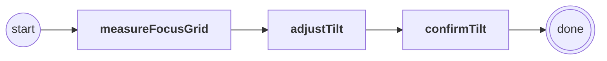
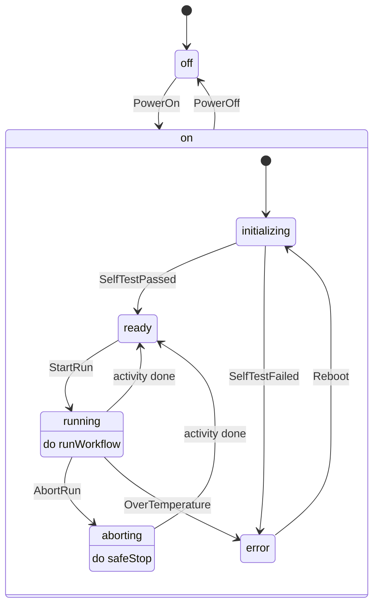
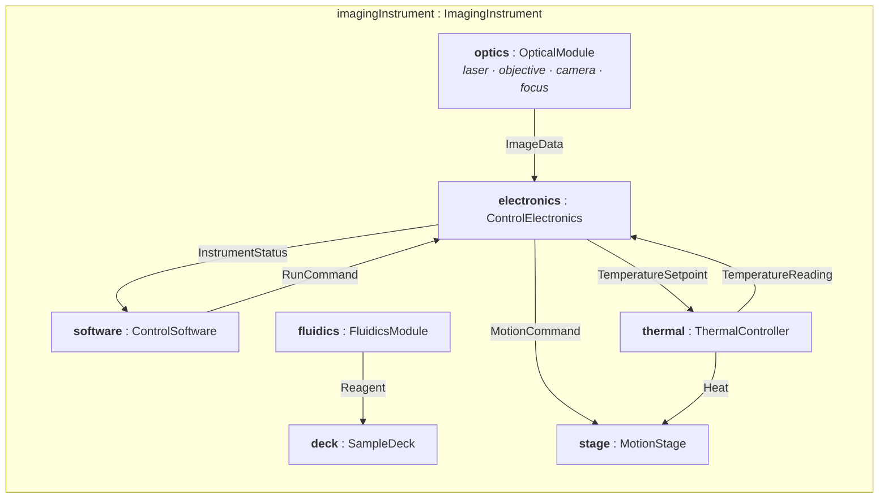
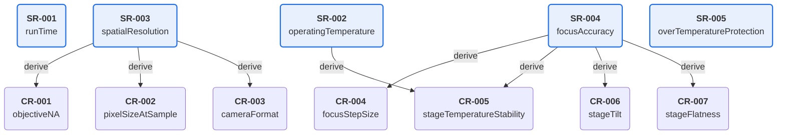
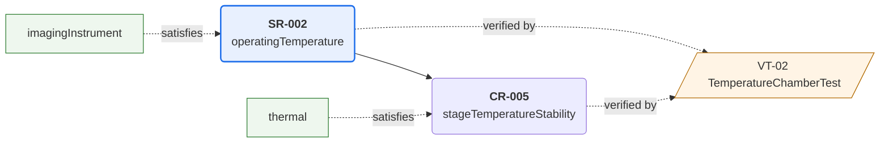
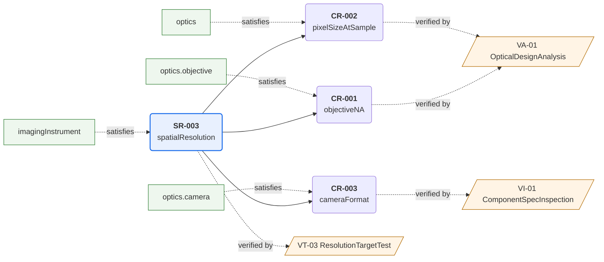
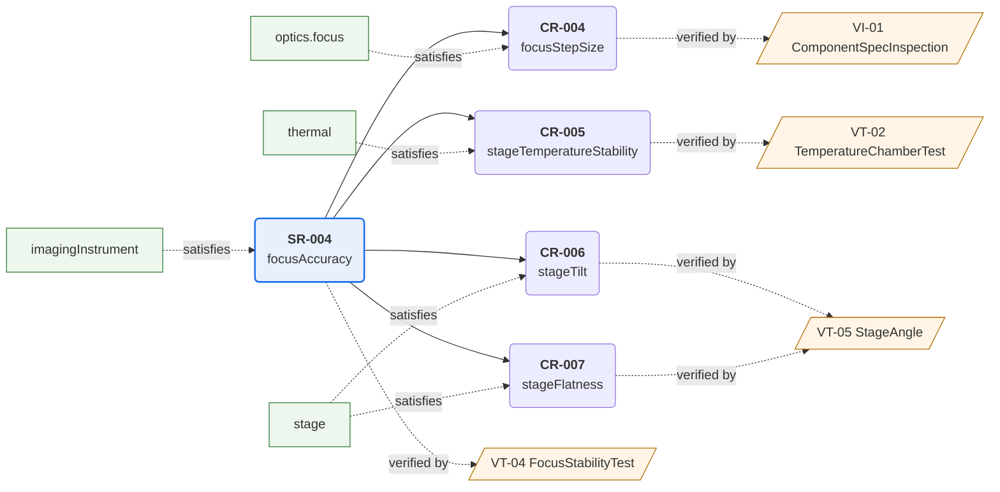
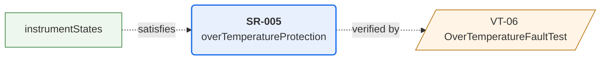

# Model check report: BenchtopImager

Source: `BenchtopImager.sysml` · generated by `tools/model_check.py`

## Summary

- 12 requirements, 8 verification activities, 12 functions, 12 parts
- **0 errors, 0 warnings**

## 1. Requirement coverage

Rule: every requirement needs a satisfy (what meets it) and a verify (how it is proven). Every requirement except top-level ones (ID starting SR) also needs a parent. Gaps found: **0**.

| ID | Requirement | Derived from | Satisfied by | Verified by | Status |
|---|---|---|---|---|---|
| SR-001 | runTime | (top level) | imagingInstrument | VT-01 | OK |
| SR-002 | operatingTemperature | (top level) | imagingInstrument | VT-02 | OK |
| SR-003 | spatialResolution | (top level) | imagingInstrument | VT-03 | OK |
| SR-004 | focusAccuracy | (top level) | imagingInstrument | VT-04 | OK |
| SR-005 | overTemperatureProtection | (top level) | instrumentStates | VT-06 | OK |
| CR-001 | objectiveNA | SR-003 | optics.objective | VA-01 | OK |
| CR-002 | pixelSizeAtSample | SR-003 | optics | VA-01 | OK |
| CR-003 | cameraFormat | SR-003 | optics.camera | VI-01 | OK |
| CR-004 | focusStepSize | SR-004 | optics.focus | VI-01 | OK |
| CR-005 | stageTemperatureStability | SR-004, SR-002 | thermal | VT-02 | OK |
| CR-006 | stageTilt | SR-004 | stage | VT-05 | OK |
| CR-007 | stageFlatness | SR-004 | stage | VT-05 | OK |

## 2. Requirement quality

Rule-based lint: one "shall" per requirement, a measurable value, and none of the usual vague words (fast, sharp, user-friendly, approximately, ...).

| ID | Requirement text | Result |
|---|---|---|
| SR-001 | The instrument shall deliver analysis results within 2 hours of the start of a run, for a full sample load | OK |
| SR-002 | The instrument shall meet all performance requirements when operated at ambient temperatures from 15 to 25 °C. | OK |
| SR-003 | The instrument shall resolve features as small as 1 µm across the full imaging area. | OK |
| SR-004 | The instrument shall keep the sample within ±0.5 µm of best focus across the imaging area throughout a run. | OK |
| SR-005 | If the stage temperature exceeds 40 °C during a run, the instrument shall stop heating and laser emission within 5 seconds, end the run, and show an over-temperature error to the user. | OK |
| CR-001 | The objective shall have a numerical aperture of at least 0.4. | OK |
| CR-002 | The optics and camera shall provide a pixel size at the sample of 0.5 um or less. | OK |
| CR-003 | The camera shall have at least 1920 x 1080 pixels. | OK |
| CR-004 | The focus drive shall move in steps of 0.1 um or smaller. | OK |
| CR-005 | The thermal controller shall hold the stage within +/-0.5 C of setpoint at ambient temperatures from 15 to 25 C. | OK |
| CR-006 | After alignment, the sample plane shall be perpendicular to the optical axis within 0.5 mrad. | OK |
| CR-007 | The stage surface shall be flat within 0.3 µm peak-to-valley across the imaging area, after tilt removal. | OK |

## 3. Verification consistency

Each verification activity should name a standard method (Test, Analysis, Inspection, Demonstration) that matches its ID prefix, state a pass criterion, and mention every value (with units) from the requirements it verifies. The value check is a text heuristic: it flags likely mismatches for a person to review.

| ID | Activity | Method | Verifies | Result |
|---|---|---|---|---|
| VT-01 | RunTimeTest | Test | SR-001 | OK |
| VT-02 | TemperatureChamberTest | Test | SR-002, CR-005 | OK |
| VT-03 | ResolutionTargetTest | Test | SR-003 | OK |
| VT-04 | FocusStabilityTest | Test | SR-004 | OK |
| VT-05 | StageAngle | Test | CR-006, CR-007 | OK |
| VT-06 | OverTemperatureFaultTest | Test | SR-005 | OK |
| VA-01 | OpticalDesignAnalysis | Analysis | CR-001, CR-002 | OK |
| VI-01 | ComponentSpecInspection | Inspection | CR-003, CR-004 | OK |

## 4. Functional allocation

Every function (workflow step or state activity) should be allocated to a part, and every part should either perform a function or satisfy a requirement.

| Function | Allocated to |
|---|---|
| runWorkflow.loadSample | deck |
| runWorkflow.primeFluidics | fluidics |
| runWorkflow.heatToSetpoint | thermal |
| runWorkflow.positionSample | stage |
| runWorkflow.alignStage.measureFocusGrid | optics |
| runWorkflow.alignStage.adjustTilt | stage |
| runWorkflow.alignStage.confirmTilt | optics |
| runWorkflow.autofocus | optics.focus |
| runWorkflow.acquireImages | optics.camera, optics.laser |
| runWorkflow.processImages | electronics |
| runWorkflow.reportResults | software |
| imagingInstrument.instrumentStates.on.aborting.safeStop | electronics |

| Part | Functions | Satisfies | Status |
|---|---|---|---|
| imagingInstrument | — | SR-001, SR-002, SR-003, SR-004 | OK |
| deck | loadSample | — | OK |
| fluidics | primeFluidics | — | OK |
| stage | alignStage.adjustTilt, positionSample | CR-006, CR-007 | OK |
| thermal | heatToSetpoint | CR-005 | OK |
| electronics | instrumentStates.on.aborting.safeStop, processImages | — | OK |
| software | reportResults | — | OK |
| optics | alignStage.confirmTilt, alignStage.measureFocusGrid | CR-002 | OK |
| optics.laser | acquireImages | — | OK |
| optics.objective | — | CR-001 | OK |
| optics.camera | acquireImages | CR-003 | OK |
| optics.focus | autofocus | CR-004 | OK |

## 5. Workflows

### RunWorkflow

One full run, from sample loading to results. SR-001 allows 120 minutes.

Critical path: **110 min**. Steps with zero slack: loadSample, primeFluidics, heatToSetpoint, positionSample, alignStage, autofocus, acquireImages, processImages, reportResults. Limit 120 min: margin **10 min**.

| Step | Type | Duration (min) | Slack (min) | Critical |
|---|---|---|---|---|
| loadSample |  | 5 | 0 | yes |
| primeFluidics |  | 10 | 0 | yes |
| heatToSetpoint |  | 10 | 0 | yes |
| positionSample |  | 2 | 0 | yes |
| alignStage | AlignStage | 3 | 0 | yes |
| autofocus |  | 5 | 0 | yes |
| acquireImages |  | 60 | 0 | yes |
| processImages |  | 20 | 0 | yes |
| reportResults |  | 5 | 0 | yes |

```mermaid
flowchart LR
  a_start(("start"))
  a_loadSample["<b>loadSample</b><br/>5 min · → deck"]:::crit
  a_prepFork["fork"]:::bar
  a_primeFluidics["<b>primeFluidics</b><br/>10 min · → fluidics"]:::crit
  a_heatToSetpoint["<b>heatToSetpoint</b><br/>10 min · → thermal"]:::crit
  a_prepJoin["join"]:::bar
  a_positionSample["<b>positionSample</b><br/>2 min · → stage"]:::crit
  a_alignStage["<b>alignStage</b> : AlignStage<br/>3 min<br/><i>measureFocusGrid (optics) → adjustTilt (stage) → confirmTilt (optics)</i>"]:::crit
  a_autofocus["<b>autofocus</b><br/>5 min · → optics.focus"]:::crit
  a_acquireImages["<b>acquireImages</b><br/>60 min · → optics.camera, optics.laser"]:::crit
  a_processImages["<b>processImages</b><br/>20 min · → electronics"]:::crit
  a_reportResults["<b>reportResults</b><br/>5 min · → software"]:::crit
  a_done((("done")))
  a_start --> a_loadSample
  a_loadSample --> a_prepFork
  a_prepFork --> a_primeFluidics
  a_prepFork --> a_heatToSetpoint
  a_primeFluidics --> a_prepJoin
  a_heatToSetpoint --> a_prepJoin
  a_prepJoin --> a_positionSample
  a_positionSample --> a_alignStage
  a_alignStage --> a_autofocus
  a_autofocus --> a_acquireImages
  a_acquireImages --> a_processImages
  a_processImages --> a_reportResults
  a_reportResults --> a_done
  classDef bar fill:#333,color:#fff,stroke:#333
  classDef crit stroke:#1f6feb,stroke-width:3px
  classDef dead fill:#fdecea,stroke:#c0392b,stroke-width:3px,stroke-dasharray:6 3
  linkStyle 0,1,2,3,4,5,6,7,8,9,10,11,12 stroke:#1f6feb,stroke-width:3px
```

### AlignStage

Runs in every run, after the stage reaches setpoint: level the sample plane to within 0.5 mrad of the optical axis (CR-006).

| Step |
|---|
| measureFocusGrid |
| adjustTilt |
| confirmTilt |

## 6. State machines

### InstrumentStates

Operating modes of the instrument, from power-on to power-off.

6 states, 10 transitions. Each transition below is one test case: put the instrument in the starting state, cause the event, and confirm the expected state.

| Test case | From state | Event | Expected state |
|---|---|---|---|
| TC-01 | off | PowerOn | on → initializing |
| TC-02 | on (any state inside) | PowerOff | off |
| TC-03 | initializing | SelfTestPassed | ready |
| TC-04 | initializing | SelfTestFailed | error |
| TC-05 | ready | StartRun | running |
| TC-06 | running | activity completes | ready |
| TC-07 | running | AbortRun | aborting |
| TC-08 | running | OverTemperature | error |
| TC-09 | aborting | activity completes | ready |
| TC-10 | error | Reboot | initializing |

## 7. Analysis (computed from the model)

### FocusErrorBudget

Focus error budget for SR-004 (+/-0.5 um). Contributors combined by RSS.

| Attribute | Formula | Value |
|---|---|---|
| allocation_um |  | 0.5 |
| thermalSensitivity_um_per_C |  | 0.5 |
| driveQuantization_um | imagingInstrument.optics.focus.stepSize_um / 2 | 0.025 |
| thermalDrift_um | thermalSensitivity_um_per_C * imagingInstrument.thermal.setpointStability_C | 0.15 |
| stageFlatness_um |  | 0.3 |
| autofocusRepeatability_um |  | 0.2 |
| total_um | RSS4(driveQuantization_um, thermalDrift_um, stageFlatness_um, autofocusRepeatability_um) | 0.3913 |
| margin_um | allocation_um - total_um | 0.1087 |

- from the design: `imagingInstrument.optics.focus.stepSize_um` = 0.05
- from the design: `imagingInstrument.thermal.setpointStability_C` = 0.3

## 8. Diagrams generated from the model

### Structure and interfaces: imagingInstrument

### Requirement tree

### Traceability thread: SR-001 runTime

Solid arrows: requirement derived from its parent. Green: the part that satisfies it. Orange: the activity that verifies it.

### Traceability thread: SR-002 operatingTemperature

Solid arrows: requirement derived from its parent. Green: the part that satisfies it. Orange: the activity that verifies it.

### Traceability thread: SR-003 spatialResolution

Solid arrows: requirement derived from its parent. Green: the part that satisfies it. Orange: the activity that verifies it.

### Traceability thread: SR-004 focusAccuracy

Solid arrows: requirement derived from its parent. Green: the part that satisfies it. Orange: the activity that verifies it.

### Traceability thread: SR-005 overTemperatureProtection

Solid arrows: requirement derived from its parent. Green: the part that satisfies it. Orange: the activity that verifies it.

## Notes

Every statement in the model was interpreted.
